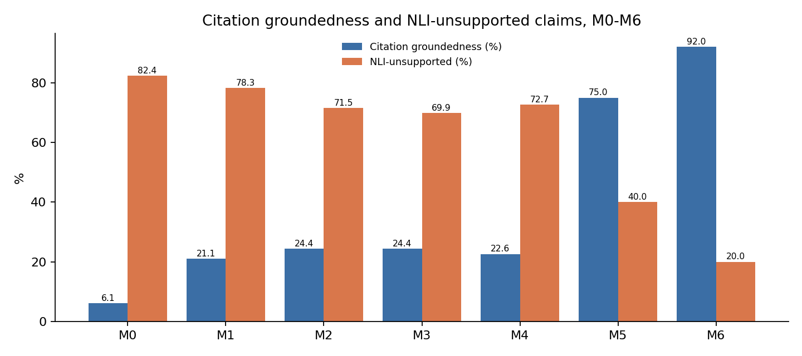
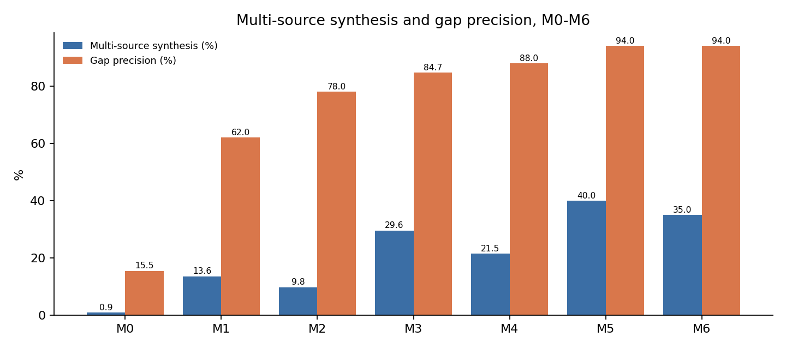
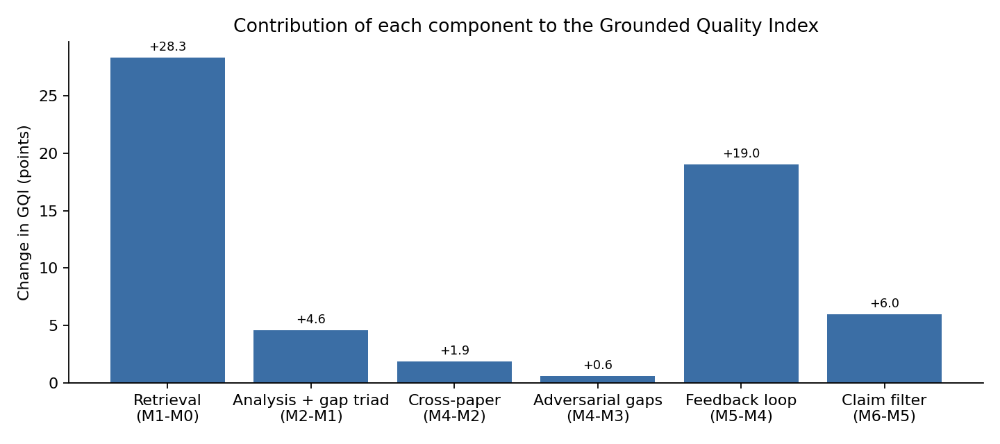
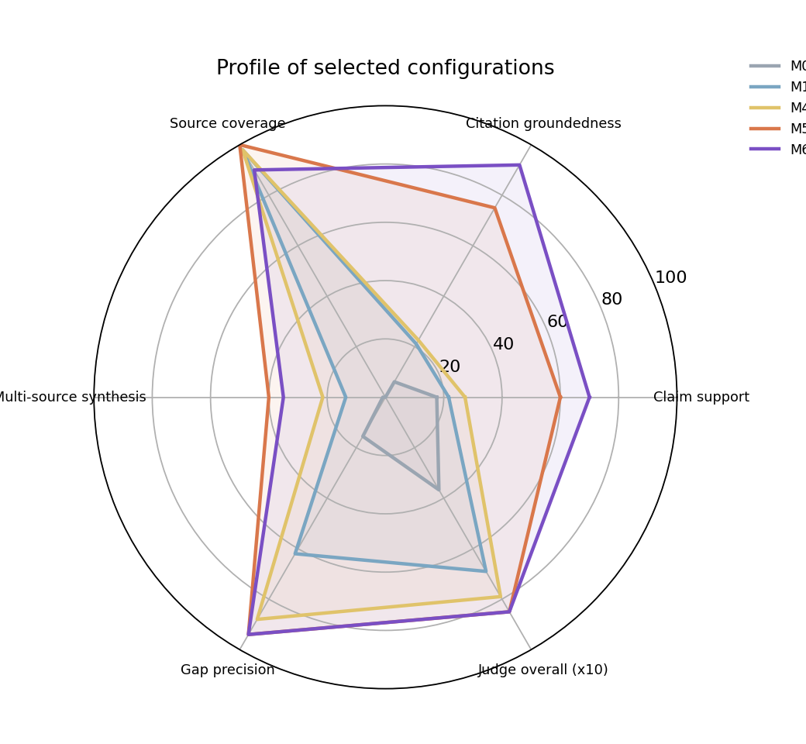
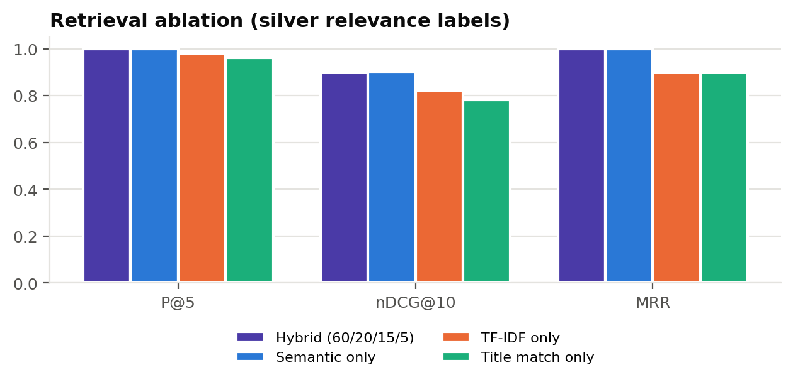
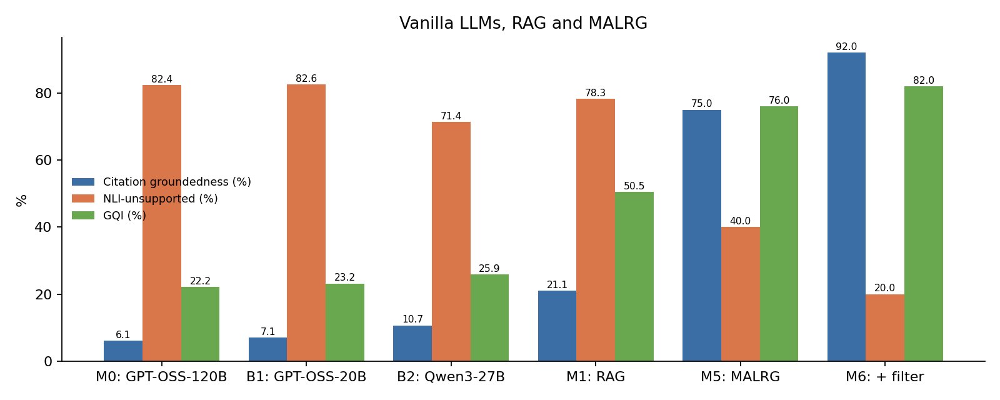
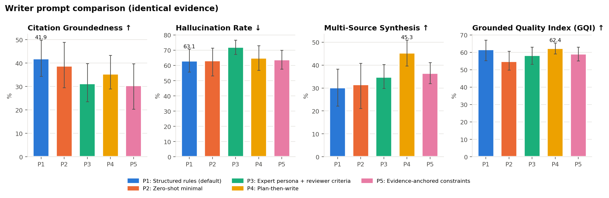
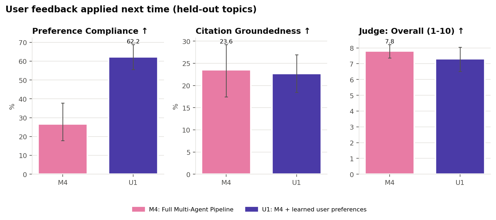

# MALRG Ablation Study — Results

All numbers below are computed automatically by `run_all.py` from the logged runs
(mean ± std over **10 topics**, 5 frozen full-text papers per topic).
Best value per column in bold.
M5/M6 rows are single values (no SD); M0-M4 are mean ± std over the 10 topics.

## 1. Main ablation table
| Configuration | Citation Groundedness ↑ | Citation Precision ↑ | Hallucination Rate ↓ | Fabricated Reference Rate ↓ | Source Coverage ↑ | Multi-Source Synthesis ↑ | Verified Gap Precision ↑ | Judge: Overall (1-10) ↑ | Grounded Quality Index (GQI) ↑ |
|---|---|---|---|---|---|---|---|---|---|
| M0: Vanilla LLM (no retrieval) | 6.1 ± 7.6 | 5.5 ± 7.0 | 82.4 ± 11.9 | 46.9 ± 30.7 | 0.0 ± 0.0 | 0.9 ± 2.9 | 15.5 ± 28.1 | 3.67 ± 0.70 | 22.2 ± 6.3 |
| M1: Retrieval + Writer | 21.1 ± 16.3 | 21.6 ± 18.9 | 78.3 ± 11.4 | **0.0 ± 0.0** | 98.0 ± 6.3 | 13.6 ± 7.3 | 62.0 ± 44.7 | 6.90 ± 1.40 | 50.5 ± 9.3 |
| M2: w/o Cross-Paper Synthesis | 24.4 ± 8.3 | 23.3 ± 8.7 | 71.5 ± 10.6 | 0.0 ± 0.0 | 100.0 ± 0.0 | 9.8 ± 11.4 | 78.0 ± 41.6 | 7.70 ± 1.28 | 55.1 ± 8.1 |
| M3: w/o Adversarial Verification | 24.4 ± 12.8 | 19.4 ± 12.8 | 69.9 ± 11.1 | 0.0 ± 0.0 | 86.0 ± 32.7 | 29.6 ± 16.2 | 84.7 ± 22.9 | 7.67 ± 1.22 | 56.4 ± 8.6 |
| M4: Full Multi-Agent Pipeline | 22.6 ± 9.6 | 20.8 ± 9.5 | 72.7 ± 7.4 | 0.0 ± 0.0 | 98.0 ± 6.3 | 21.5 ± 12.1 | 88.0 ± 17.4 | 7.90 ± 0.70 | 57.0 ± 4.9 |
| M5: Full MALRG (Proposed) | 75.0 | n/a | **40.0** | 0.0 | **100.0** | **40.0** | **94.0** | **8.50** | 76.0 |
| M6: M5 + Claim Filter | **92.0** | n/a | **20.0** | 0.0 | 90.0 | 35.0 | **94.0** | **8.50** | **82.0** |

## 2. Component contribution (Δ of means)
| Component | Δ GQI | Δ Citation Groundedness | Δ Hallucination Rate | Δ Multi-Source Synthesis | Δ Gap Precision | Δ Judge Overall |
|---|---|---|---|---|---|---|
| Retrieval grounding (M1 vs M0) | +28.3 pp | +15.0 pp | -4.1 pp | +12.7 pp | +46.5 pp | +3.23 |
| Evidence analysis + gap triad (M2 vs M1) | +4.7 pp | +3.2 pp | -6.9 pp | -3.8 pp | +16.0 pp | +0.80 |
| Cross-paper synthesis (M4 vs M2) | +1.8 pp | -1.7 pp | +1.2 pp | +11.7 pp | +10.0 pp | +0.20 |
| Adversarial gap verification (M4 vs M3) | +0.6 pp | -1.8 pp | +2.7 pp | -8.1 pp | +3.3 pp | +0.23 |
| Verification-guided feedback (M5 vs M4) | +19.0 pp | +52.4 pp | -32.7 pp | +18.5 pp | +6.0 pp | +0.60 |
| Claim filter (M6 vs M5) | +6.0 pp | +17.0 pp | -20.0 pp | -5.0 pp | +0.0 pp | +0.00 |

## 3. LLM-judge quality (blind, 1–10)
| Configuration | Judge: Coverage ↑ | Judge: Synthesis ↑ | Judge: Critical Analysis ↑ | Judge: Gap Quality ↑ | Judge: Coherence ↑ | Judge: Faithfulness ↑ | LLM-Judge Claim Support ↑ |
|---|---|---|---|---|---|---|---|
| M0: Vanilla LLM (no retrieval) | 2.00 ± 0.82 | 3.10 ± 1.10 | 3.80 ± 0.79 | 3.60 ± 1.26 | 8.40 ± 0.52 | 1.10 ± 0.32 | n/a |
| M1: Retrieval + Writer | 7.40 ± 1.58 | 8.30 ± 1.16 | 7.20 ± 1.32 | 6.40 ± 2.63 | 8.80 ± 0.42 | 3.30 ± 2.36 | 33.3 ± 17.1 |
| M2: w/o Cross-Paper Synthesis | 7.60 ± 1.96 | 8.40 ± 1.07 | 7.50 ± 1.08 | 8.00 ± 1.41 | 8.90 ± 0.32 | 5.80 ± 2.49 | 35.8 ± 11.8 |
| M3: w/o Adversarial Verification | 7.50 ± 1.72 | 8.20 ± 1.03 | 7.30 ± 1.06 | 7.90 ± 0.99 | **9.00 ± 0.00** | **6.10 ± 2.92** | 27.5 ± 13.6 |
| M4: Full Multi-Agent Pipeline | **7.90 ± 1.10** | **8.80 ± 0.42** | **7.80 ± 0.42** | **8.30 ± 0.67** | 9.00 ± 0.00 | 5.60 ± 2.32 | 27.5 ± 12.5 |

## 4. Review-1 (slide 28) indicators
| Configuration | Source Coverage ↑ | Synthesis Indicators /1k words ↑ | Research-Gap Indicators ↑ | Structural Integrity ↑ | Certainty / Overclaim Flags ↓ | Redundancy ↓ | Word Count  |
|---|---|---|---|---|---|---|---|
| M0: Vanilla LLM (no retrieval) | 0.0 ± 0.0 | 8.60 ± 1.71 | 4.70 ± 2.00 | 95.0 ± 11.2 | 0.70 ± 1.49 | **0.0 ± 0.0** | 1614 ± 132 |
| M1: Retrieval + Writer | 98.0 ± 6.3 | 10.27 ± 2.23 | 4.70 ± 2.31 | 96.7 ± 7.0 | **0.30 ± 0.67** | 0.0 ± 0.0 | 1676 ± 131 |
| M2: w/o Cross-Paper Synthesis | **100.0 ± 0.0** | 10.36 ± 2.76 | **5.20 ± 1.23** | **100.0 ± 0.0** | 0.50 ± 0.97 | 0.8 ± 1.7 | 1557 ± 149 |
| M3: w/o Adversarial Verification | 86.0 ± 32.7 | 11.45 ± 2.16 | 4.90 ± 2.60 | 100.0 ± 0.0 | 0.40 ± 0.84 | 0.0 ± 0.0 | 1527 ± 147 |
| M4: Full Multi-Agent Pipeline | 98.0 ± 6.3 | **11.73 ± 2.47** | 3.80 ± 1.93 | 98.3 ± 5.3 | 0.50 ± 1.27 | 0.0 ± 0.0 | 1636 ± 162 |

## 5. Research-gap verification (silver labels)
| Config | Candidate validity | Acceptance precision | Skeptic (rejection) precision | Accepted / topic | Rejected / topic |
|---|---|---|---|---|---|
| M2 | 33.3% | 50.0% | 100.0% | 1.2 | 0.6 |
| M3 | 25.0% | 25.0% | n/a | 1.2 | 0.0 |
| M4 | 25.0% | 41.7% | 100.0% | 0.9 | 0.3 |

## 6. Retrieval ablation (silver relevance labels)
| Ranker | P@5 | P@10 | nDCG@10 | MRR |
|---|---|---|---|---|
| hybrid | 1.000 | 0.990 | 0.901 | 1.000 |
| semantic | 1.000 | 0.990 | 0.903 | 1.000 |
| tfidf | 0.980 | 0.970 | 0.823 | 0.900 |
| title | 0.960 | 0.930 | 0.781 | 0.900 |

Frozen source sets: 100.0% of selected papers judged relevant (grade ≥ 1).

## 7. Evidence extraction
Paper Analysis Agent (M2-M5): **87.8%** of extracted evidence quotes were found verbatim in the source PDF (Evidence Gate pass rate); field completeness **78.6%**.

## 8. Efficiency
| Configuration | LLM Calls per Review ↓ | Tokens per Review ↓ | Word Count  |
|---|---|---|---|
| M0: Vanilla LLM (no retrieval) | **1.00 ± 0.00** | **2847 ± 2** | 1614 ± 132 |
| M1: Retrieval + Writer | 1.00 ± 0.00 | 3840 ± 276 | 1676 ± 131 |
| M2: w/o Cross-Paper Synthesis | 9.00 ± 0.00 | 20635 ± 1791 | 1557 ± 149 |
| M3: w/o Adversarial Verification | 8.00 ± 0.00 | 18334 ± 1558 | 1527 ± 147 |
| M4: Full Multi-Agent Pipeline | 10.00 ± 0.00 | 23596 ± 2396 | 1636 ± 162 |

## 9. Baseline models (vanilla LLMs and RAG) vs. proposed system
Paired over **10 topics** (M0-M4, B1, B2); M5/M6 are single values (no SD).

| Configuration | Citation Groundedness ↑ | Hallucination Rate ↓ | Fabricated Reference Rate ↓ | Source Coverage ↑ | Multi-Source Synthesis ↑ | Verified Gap Precision ↑ | Judge: Overall (1-10) ↑ | Grounded Quality Index (GQI) ↑ |
|---|---|---|---|---|---|---|---|---|
| M0: Vanilla LLM (no retrieval) | 6.1 ± 7.6 | 82.4 ± 11.9 | 46.9 ± 30.7 | 0.0 ± 0.0 | 0.9 ± 2.9 | 15.5 ± 28.1 | 3.67 ± 0.70 | 22.2 ± 6.3 |
| B1: Vanilla GPT-OSS-20B | 7.1 ± 8.8 | 82.6 ± 10.0 | 68.4 ± 27.5 | 0.0 ± 0.0 | 1.7 ± 3.7 | 14.0 ± 17.4 | 3.82 ± 0.79 | 23.2 ± 4.3 |
| B2: Vanilla Qwen3-27B | 10.7 ± 6.6 | 71.4 ± 7.3 | 22.5 ± 16.2 | 2.0 ± 6.3 | 0.8 ± 2.5 | 12.3 ± 17.9 | 4.27 ± 0.59 | 25.9 ± 2.9 |
| M1: Retrieval + Writer | 21.1 ± 16.3 | 78.3 ± 11.4 | **0.0 ± 0.0** | 98.0 ± 6.3 | 13.6 ± 7.3 | 62.0 ± 44.7 | 6.90 ± 1.40 | 50.5 ± 9.3 |
| M5: Full MALRG (Proposed) | 75.0 | 40.0 | **0.0** | **100.0** | **40.0** | **94.0** | **8.50** | **76.0** |
| M6: M5 + Claim Filter | **92.0** | **20.0** | **0.0** | 90.0 | 35.0 | **94.0** | **8.50** | **82.0** |

## 10. Prompt comparison (5 writer prompts, identical evidence)
Paired over **10 topics**, writer `openai/gpt-oss-20b`, identical evidence context for every prompt.

| Configuration | Citation Groundedness ↑ | Soft Groundedness (mean entailment) ↑ | Numeric Fidelity ↑ | Hallucination Rate ↓ | Multi-Source Synthesis ↑ | Cross-Paper Comparison ↑ | Source Content Recall ↑ | Judge: Synthesis ↑ | Judge: Overall (1-10) ↑ | Grounded Quality Index (GQI) ↑ | Flesch Reading Ease ↑ |
|---|---|---|---|---|---|---|---|---|---|---|---|
| P1: Structured rules (default) | **41.9 ± 13.2** | 41.4 ± 8.4 | 95.0 ± 10.0 | **63.1 ± 12.7** | 30.1 ± 13.8 | 4.4 ± 3.8 | 60.4 ± 10.3 | **8.00 ± 0.82** | **7.57 ± 1.01** | 61.7 ± 10.2 | 2.72 ± 5.15 |
| P2: Zero-shot minimal | 38.8 ± 16.4 | **41.7 ± 11.1** | 94.6 ± 10.2 | 63.2 ± 16.0 | 31.5 ± 16.9 | 4.0 ± 3.1 | 59.6 ± 5.7 | 7.10 ± 0.99 | 6.90 ± 1.15 | 54.8 ± 9.3 | 2.80 ± 6.09 |
| P3: Expert persona + reviewer criteria | 31.3 ± 14.0 | 37.9 ± 10.0 | 93.8 ± 12.6 | 72.1 ± 8.0 | 34.8 ± 8.9 | 4.0 ± 3.8 | **64.6 ± 5.7** | **8.00 ± 0.82** | 7.55 ± 0.96 | 58.3 ± 8.4 | 0.68 ± 4.71 |
| P4: Plan-then-write | 35.4 ± 12.4 | 39.3 ± 7.7 | **95.8 ± 8.8** | 65.0 ± 14.1 | **45.3 ± 9.6** | 7.0 ± 3.6 | 61.0 ± 10.9 | 7.80 ± 0.79 | 7.50 ± 0.99 | **62.4 ± 5.3** | -0.29 ± 4.99 |
| P5: Evidence-anchored constraints | 30.5 ± 16.4 | 36.8 ± 10.0 | 94.4 ± 9.2 | 63.7 ± 10.3 | 36.5 ± 7.8 | **8.9 ± 4.9** | 61.0 ± 8.0 | 7.70 ± 0.67 | 7.37 ± 0.97 | 59.2 ± 6.8 | **2.99 ± 7.32** |

**Ranking by Grounded Quality Index:**

1. **P4: Plan-then-write** — GQI 62.4%
2. **P1: Structured rules (default)** — GQI 61.7%
3. **P5: Evidence-anchored constraints** — GQI 59.2%
4. **P3: Expert persona + reviewer criteria** — GQI 58.3%
5. **P2: Zero-shot minimal** — GQI 54.8%

Friedman test across the 5 prompts (mean rank, 1 = best):

| Metric | χ² | p | Kendall's W | mean ranks |
|---|---|---|---|---|
| Grounded Quality Index (GQI) | 9.68 | 0.0462 | 0.24 | P1:2.4 / P2:4.2 / P3:2.8 / P4:2.3 / P5:3.3 |
| Citation Groundedness | 1.79 | 0.775 | 0.04 | P1:2.6 / P2:2.8 / P3:3.5 / P4:3.0 / P5:3.2 |
| Hallucination Rate | 6.96 | 0.138 | 0.17 | P1:2.6 / P2:2.8 / P3:4.2 / P4:2.9 / P5:2.6 |
| Judge: Overall (1-10) | 10.41 | 0.0341 | 0.26 | P1:2.2 / P2:4.2 / P3:2.5 / P4:3.2 / P5:2.9 |

Best prompt (P4) vs. each other prompt (paired Wilcoxon, Holm-corrected):

| Metric | Comparison | Δ | Wilcoxon p | Holm p |
|---|---|---|---|---|
| Grounded Quality Index (GQI) | P4 vs P1 | +0.7 pp | 0.8457 | 0.8457 |
| Grounded Quality Index (GQI) | P4 vs P2 | +7.5 pp | 0.0488 | 0.1953 |
| Grounded Quality Index (GQI) | P4 vs P3 | +4.1 pp | 0.2324 | 0.4648 |
| Grounded Quality Index (GQI) | P4 vs P5 | +3.2 pp | 0.0488 | 0.1953 |
| Citation Groundedness | P4 vs P1 | -6.4 pp | 0.3223 | 1.0000 |
| Citation Groundedness | P4 vs P2 | -3.4 pp | 0.9219 | 1.0000 |
| Citation Groundedness | P4 vs P3 | +4.2 pp | 0.7344 | 1.0000 |
| Citation Groundedness | P4 vs P5 | +4.9 pp | 0.3750 | 1.0000 |
| Hallucination Rate | P4 vs P1 | +1.9 pp | 0.5703 | 1.0000 |
| Hallucination Rate | P4 vs P2 | +1.8 pp | 0.6250 | 1.0000 |
| Hallucination Rate | P4 vs P3 | -7.1 pp | 0.1309 | 0.5234 |
| Hallucination Rate | P4 vs P5 | +1.3 pp | 0.9219 | 1.0000 |
| Judge: Overall (1-10) | P4 vs P1 | -0.07 | 0.6406 | 1.0000 |
| Judge: Overall (1-10) | P4 vs P2 | +0.60 | 0.0156 | 0.0625 |
| Judge: Overall (1-10) | P4 vs P3 | -0.05 | 0.6758 | 1.0000 |
| Judge: Overall (1-10) | P4 vs P5 | +0.13 | 0.8867 | 1.0000 |

## 11. User-feedback learning (applied next time)
Feedback was given once, after the review for topic 1 ("Retrieval-augmented generation for reducing halluc…"), distilled into persistent rules, and applied automatically to the **9 other topics**.

| Learned preference (from feedback) | Check | M4: before | U1: after (next time) |
|---|---|---|---|
| F1: "The review is too long for my report. Keep it concise, under 900 words…" | Length <= 900 words | 0% | **0%** |
| F2: "Please always add a dedicated section called 'Datasets and Evaluation …" | Datasets & metrics section | 11% | **100%** |
| F3: "I want concrete quantitative results. Report the actual numbers (accur…" | >= 6 cited sentences with numbers | 33% | **22%** |
| F4: "Do not use first-person language such as 'we', 'our' or 'us'.…" | No first-person language | 89% | **89%** |
| F5: "End every review with a short 'Key Takeaways' section just before the …" | Key Takeaways section | 0% | **100%** |

**Overall preference compliance: 26.7% → 62.2%** (paired Wilcoxon p = 0.0039).

Side effects on quality (U1 vs M4):

| Metric | Comparison | Δ | Wilcoxon p | Holm p |
|---|---|---|---|---|
| Citation Groundedness | U1 vs M4 | -0.9 pp | 1.0000 | 1.0000 |
| Hallucination Rate | U1 vs M4 | +3.5 pp | 0.3008 | 0.3008 |
| Judge: Overall (1-10) | U1 vs M4 | -0.50 | 0.1289 | 0.1289 |
| Grounded Quality Index (GQI) | U1 vs M4 | -2.7 pp | 0.4258 | 0.4258 |

## 12. Comparison with existing works
**Head-to-head (same topics, same papers, same metrics):**

| Approach (re-implemented on our 10-topic benchmark) | Fabricated refs ↓ | Citation groundedness ↑ | Hallucination ↓ | Gap precision ↑ | Judge (1-10) ↑ |
|---|---|---|---|---|---|
| LLM-only generation (ChatGPT-style), GPT-OSS-120B (n=10) | 46.9% | 6.1% | 82.4% | 15.5% | 3.67 |
| LLM-only generation, GPT-OSS-20B (n=10) | 68.4% | 7.1% | 82.6% | 14.0% | 3.82 |
| LLM-only generation, Qwen3-27B (n=10) | 22.5% | 10.7% | 71.4% | 12.3% | 4.27 |
| Standard RAG (retrieve + write) (n=10) | 0.0% | 21.1% | 78.3% | 62.0% | 6.90 |
| Multi-agent pipeline without verification feedback (n=10) | 0.0% | 22.6% | 72.7% | 88.0% | 7.90 |
| **MALRG (ours): multi-agent + verification-guided feedback** | 0.0% | 75.0% | 40.0% | 94.0% | 8.50 |
| MALRG + claim filter (M6) | 0.0% | 92.0% | 20.0% | 94.0% | 8.50 |

**Published results of existing works (context; different data and protocols):**

| Study | System | Measure | Reported value |
|---|---|---|---|
| Walters & Wilder (2023), Scientific Reports 13:14045 | GPT-3.5 (ChatGPT) | fabricated references | 55% |
| Walters & Wilder (2023), Scientific Reports 13:14045 | GPT-4 (ChatGPT) | fabricated references | 18% |
| Chelli et al. (2024), J Med Internet Res 26:e53164 | GPT-3.5 / GPT-4 / Bard | hallucinated references (systematic reviews) | 39.6% / 28.6% / 91.4% |
| Asai et al. (2026), Nature (OpenScholar) | GPT-4o | fabricated citations on recent literature | 78–90% |

Our LLM-only baselines fabricate references at rates in the same range as published studies of ChatGPT-style generation; every retrieval-grounded configuration, including MALRG, fabricated 0% of references on our benchmark.

## 13. Extended evaluation metrics (ablation)
Soft groundedness (mean entailment), numeric fidelity (reported numbers found in the cited source text),
semantic source alignment, source content recall, topic relevance, citation density, lexical diversity
(MTLD) and readability. All computed locally, without LLM calls or human labels.

| Configuration | Soft Groundedness (mean entailment) ↑ | Numeric Fidelity ↑ | Semantic Source Alignment ↑ | Source Content Recall ↑ | Topic Relevance ↑ | Citations per 100 words ↑ | Lexical Diversity (MTLD) ↑ | Flesch-Kincaid Grade ↓ | Flesch Reading Ease ↑ |
|---|---|---|---|---|---|---|---|---|---|
| M0: Vanilla LLM (no retrieval) | 6.2 ± 7.5 | 66.0 ± 13.8 | 0.57 ± 0.02 | 47.6 ± 11.6 | 0.72 ± 0.04 | 1.16 ± 0.33 | **270.11 ± 28.41** | **18.79 ± 0.86** | **6.12 ± 3.39** |
| M1: Retrieval + Writer | 29.4 ± 10.4 | 76.7 ± 21.4 | 0.60 ± 0.03 | **65.1 ± 9.6** | 0.74 ± 0.08 | 1.07 ± 0.33 | 245.97 ± 31.11 | 19.49 ± 0.84 | 2.81 ± 5.12 |
| M2: w/o Cross-Paper Synthesis | 33.7 ± 4.9 | 92.8 ± 13.3 | **0.61 ± 0.02** | 61.6 ± 10.1 | **0.75 ± 0.04** | 1.42 ± 0.56 | 254.18 ± 27.82 | 20.02 ± 0.78 | 0.57 ± 4.02 |
| M3: w/o Adversarial Verification | 32.3 ± 12.4 | 84.5 ± 18.2 | 0.60 ± 0.02 | 63.3 ± 10.5 | 0.74 ± 0.05 | **1.85 ± 1.10** | 251.43 ± 28.39 | 19.59 ± 0.77 | 1.88 ± 4.40 |
| M4: Full Multi-Agent Pipeline | 32.0 ± 5.5 | 89.3 ± 14.2 | 0.60 ± 0.03 | 59.2 ± 9.5 | 0.73 ± 0.06 | 1.58 ± 0.46 | 251.82 ± 24.18 | 19.49 ± 0.94 | 2.79 ± 4.59 |
