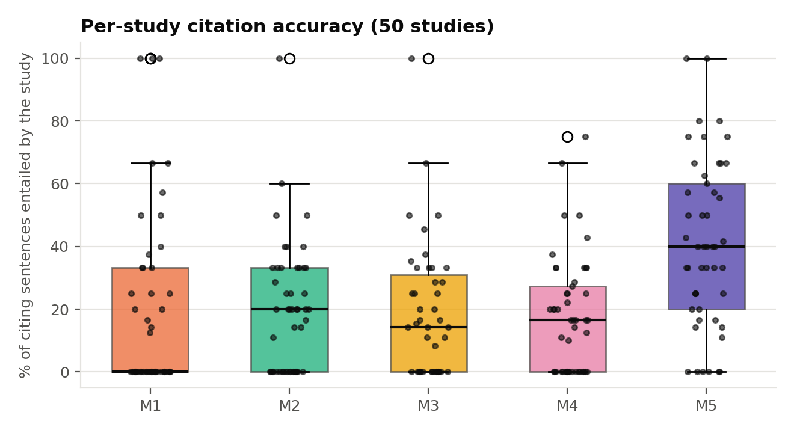
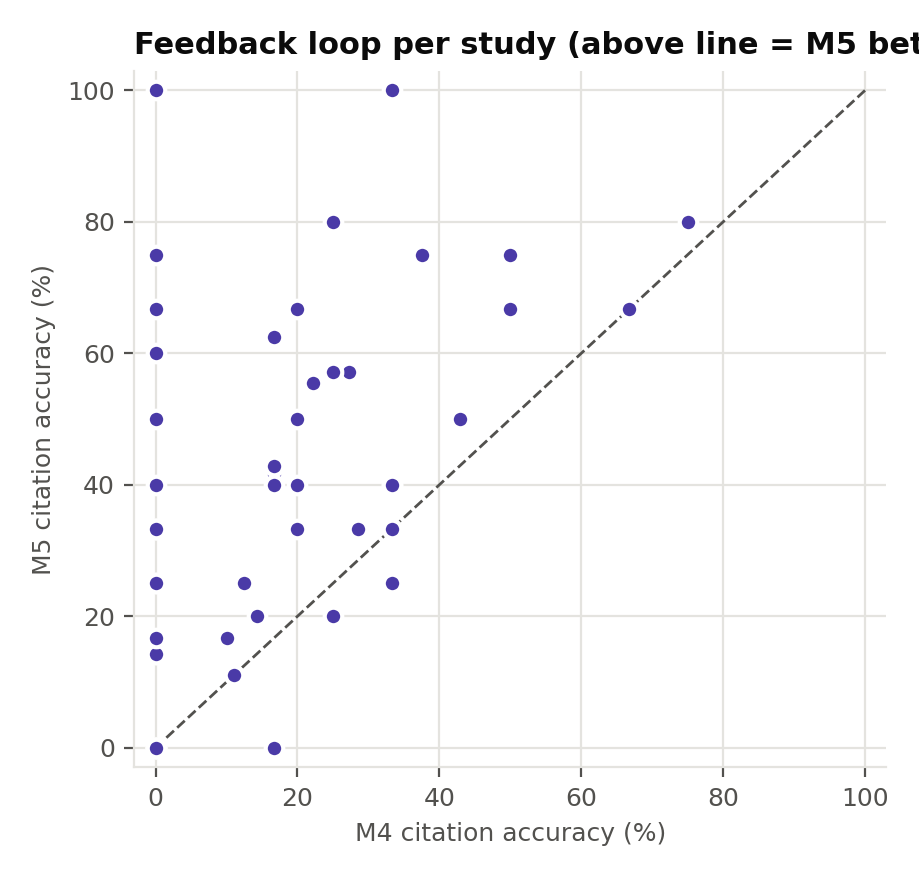

# Per-study analysis (50 studies = 10 topics x 5 frozen full-text papers)

All values are computed from the logged runs; nothing is estimated or extrapolated.
Citation accuracy = share of review sentences citing the study that are entailed by that study's own text (NLI).

## Summary

- Studies: **50** across **10** topics; sources: arXiv 28, OpenAlex 22
- Publication years: 2019–2026 (median 2024)
- Full text extracted: **428,737 words** (mean 8,575 per study)
- Evidence fidelity (quotes verified verbatim in the PDF): **88%**; field completeness **79%**; verified quotes: **175**
- Studies supporting at least one verified research gap: **41 / 50**

| Configuration | Studies cited | Sentences citing a study (mean) | Mean per-study citation accuracy |
|---|---|---|---|
| M1: Retrieval + Writer | 49 / 50 | 3.6 | 19% |
| M2: w/o Cross-Paper Synthesis | 50 / 50 | 4.3 | 19% |
| M3: w/o Adversarial Verification | 43 / 50 | 5.6 | 19% |
| M4: Full Multi-Agent Pipeline | 49 / 50 | 5.1 | 17% |
| M5: Full + Verification-Guided Feedback (Proposed) | 49 / 50 | 4.6 | 41% |
| P1: Structured rules (default) | 48 / 50 | 4.7 | 34% |
| P2: Zero-shot minimal | 48 / 50 | 3.9 | 30% |
| P3: Expert persona + reviewer criteria | 47 / 50 | 4.5 | 23% |
| P4: Plan-then-write | 50 / 50 | 7.4 | 22% |
| P5: Evidence-anchored constraints | 48 / 50 | 5.2 | 23% |
| U1: M4 + learned user preferences | 43 / 50 | 4.0 | 20% |

## Study-level significance (M5 vs. each configuration, paired Wilcoxon, Holm-corrected)

| Comparison | Studies | M5 | Other | Δ | Wins / ties / losses | Wilcoxon p | Holm p |
|---|---|---|---|---|---|---|---|
| M5 vs M1 | 48 | 41% | 19% | +21.5 pp | 35 / 5 / 8 | 0.00028 | 0.0014 ✓ |
| M5 vs M2 | 49 | 41% | 19% | +21.6 pp | 35 / 5 / 9 | 1e-05 | 9e-05 ✓ |
| M5 vs M3 | 43 | 40% | 19% | +20.9 pp | 29 / 7 / 7 | 1e-05 | 9e-05 ✓ |
| M5 vs M4 | 49 | 41% | 17% | +23.2 pp | 38 / 8 / 3 | 1.6e-07 | 1.6e-06 ✓ |
| M5 vs P1 | 48 | 40% | 34% | +6.4 pp | 25 / 6 / 17 | 0.15 | 0.15 |
| M5 vs P2 | 48 | 40% | 30% | +10.5 pp | 26 / 8 / 14 | 0.049 | 0.098 |
| M5 vs P3 | 47 | 40% | 23% | +17.6 pp | 31 / 5 / 11 | 0.0015 | 0.0056 ✓ |
| M5 vs P4 | 49 | 41% | 23% | +17.9 pp | 37 / 3 / 9 | 5.7e-05 | 0.00039 ✓ |
| M5 vs P5 | 48 | 40% | 23% | +17.5 pp | 31 / 5 / 12 | 0.0014 | 0.0056 ✓ |
| M5 vs U1 | 43 | 39% | 20% | +19.0 pp | 33 / 7 / 3 | 5.5e-05 | 0.00039 ✓ |

Note: the 5 studies of a topic share one review per configuration, so study-level tests complement (not replace) the topic-level tests in RESULTS.md.

## All 50 studies

| ID | Study (year) | Source | Words | Evidence fidelity | Field compl. | Gaps | M1 acc. | M2 acc. | M3 acc. | M4 acc. | M5 acc. |
|---|---|---|---|---|---|---|---|---|---|---|---|
| T01-S1 | Alleviating Hallucination in Large Vision-Language Models with Active  (2024) | arXiv | 8,432 | 100% | 86% | 1 | 0% | 100% | n/a | 25% | 80% |
| T01-S2 | Reducing hallucination in structured outputs via Retrieval-Augmented G (2024) | arXiv | 4,377 | 100% | 100% | 2 | 0% | 33% | n/a | 0% | 0% |
| T01-S3 | Rowen: Adaptive Retrieval-Augmented Generation for Hallucination Mitig (2024) | arXiv | 6,035 | 100% | 86% | 0 | 0% | 0% | n/a | n/a | n/a |
| T01-S4 | MEGA-RAG: a retrieval-augmented generation framework with multi-eviden (2025) | OpenAlex | 6,229 | 100% | 100% | 2 | 0% | 33% | n/a | 0% | 60% |
| T01-S5 | Hybrid Retrieval for Hallucination Mitigation in Large Language Models (2025) | arXiv | 4,794 | 100% | 86% | 2 | 33% | 0% | n/a | 20% | 40% |
| T02-S1 | Deep learning and computer vision in plant disease detection: a compre (2025) | OpenAlex | 7,084 | 75% | 100% | 2 | 17% | 33% | 35% | 27% | 57% |
| T02-S2 | Machine Learning and Deep Learning for Plant Disease Classification an (2023) | OpenAlex | 15,231 | 100% | 86% | 2 | 0% | 50% | 0% | 0% | 33% |
| T02-S3 | Deep learning-based segmentation and classification of leaf images for (2022) | OpenAlex | 8,109 | 75% | 86% | 1 | 0% | 0% | 0% | 0% | 0% |
| T02-S4 | AFD-Net: Apple Foliar Disease multi classification using deep learning (2022) | OpenAlex | 6,594 | 100% | 86% | 1 | 0% | 0% | 0% | 0% | 33% |
| T02-S5 | Leaf diseases detection using deep learning methods (2024) | arXiv | 7,998 | 0% | 86% | 1 | 0% | 0% | 0% | 0% | 0% |
| T03-S1 | Federated learning with differential privacy for breast cancer diagnos (2025) | OpenAlex | 15,561 | 100% | 100% | 1 | 50% | 20% | 67% | 0% | 75% |
| T03-S2 | Toward Production-Ready Federated Learning in Healthcare: Privacy, Orc (2026) | arXiv | 3,235 | 100% | 71% | 2 | 67% | 29% | 14% | 33% | 40% |
| T03-S3 | Vision Through the Veil: Differential Privacy in Federated Learning fo (2023) | arXiv | 5,097 | 100% | 86% | 1 | 0% | 40% | 25% | 0% | 25% |
| T03-S4 | Exploring privacy mechanisms and metrics in federated learning (2025) | OpenAlex | 12,731 | 75% | 86% | 1 | 57% | 0% | 50% | 50% | 75% |
| T03-S5 | Fairness and Privacy in Federated Learning and Their Implications in H (2023) | arXiv | 4,534 | 100% | 57% | 2 | 33% | 25% | 25% | 50% | 67% |
| T04-S1 | Explainable AI for Safe and Trustworthy Autonomous Driving: A Systemat (2024) | arXiv | 16,092 | 100% | 71% | 2 | 38% | 0% | 45% | 17% | 42% |
| T04-S2 | Towards Safe, Explainable, and Regulated Autonomous Driving (2021) | arXiv | 6,003 | 75% | 71% | 1 | 20% | 20% | 33% | 67% | 67% |
| T04-S3 | Safety Implications of Explainable Artificial Intelligence in End-to-E (2024) | arXiv | 11,349 | 100% | 71% | 3 | 0% | 33% | 38% | 43% | 50% |
| T04-S4 | DARPA's Explainable Artificial Intelligence Program (2019) | OpenAlex | 7,327 | 50% | 71% | 1 | 0% | 40% | 33% | 0% | 33% |
| T04-S5 | Study on the Helpfulness of Explainable Artificial Intelligence (2024) | arXiv | 5,726 | 100% | 100% | 1 | 0% | 20% | 0% | 20% | 33% |
| T05-S1 | A Survey of Graph Neural Networks for Drug Discovery: Recent Developme (2025) | arXiv | 11,398 | 100% | 14% | 0 | 40% | 0% | 0% | 0% | 50% |
| T05-S2 | Graph neural networks for the prediction of molecular structure-proper (2022) | arXiv | 7,159 | 50% | 71% | 0 | 0% | 0% | 0% | 0% | 0% |
| T05-S3 | Could graph neural networks learn better molecular representation for  (2021) | OpenAlex | 13,473 | 100% | 86% | 0 | 12% | 33% | 20% | 17% | 0% |
| T05-S4 | Graph Neural Networks in Modern AI-aided Drug Discovery (2025) | arXiv | 9,665 | 100% | 57% | 2 | 0% | 14% | 0% | 29% | 33% |
| T05-S5 | Advanced Graph and Sequence Neural Networks for Molecular Property Pre (2020) | arXiv | 11,069 | 75% | 86% | 1 | 0% | 60% | 17% | 38% | 75% |
| T06-S1 | From Text to Multimodality: Exploring the Evolution and Impact of Larg (2024) | arXiv | 5,877 | 67% | 86% | 1 | 100% | 50% | 14% | 25% | 57% |
| T06-S2 | A Spectrum Evaluation Benchmark for Medical Multi-Modal Large Language (2024) | arXiv | 12,255 | 100% | 100% | 2 | 100% | 20% | 14% | 0% | 14% |
| T06-S3 | A Medical Multimodal Large Language Model for Pediatric Pneumonia (2024) | arXiv | 14,117 | 75% | 86% | 1 | 50% | 0% | 20% | 0% | 14% |
| T06-S4 | A medical multimodal large language model for future pandemics (2023) | OpenAlex | 10,348 | 75% | 86% | 0 | 0% | 11% | 0% | 12% | 25% |
| T06-S5 | MMIR-TCM: Memory-Integrated Multimodal Inference and Retrieval for TCM (2026) | arXiv | 9,452 | 100% | 100% | 2 | 25% | 0% | 11% | 11% | 11% |
| T07-S1 | MACHINE LEARNING APPLICATIONS IN IOT BASED AGRICULTURE AND SMART FARMI (2020) | OpenAlex | 1,793 | 100% | 57% | 1 | n/a | 0% | 0% | 33% | 33% |
| T07-S2 | Towards a Multimodal System for Precision Agriculture using IoT and Ma (2021) | arXiv | 4,129 | 100% | 100% | 3 | 0% | 17% | 11% | 10% | 17% |
| T07-S3 | A Smart Irrigation System Using the IoT and Advanced Machine Learning  (2024) | OpenAlex | 4,978 | 100% | 100% | 2 | 0% | 20% | 17% | 17% | 43% |
| T07-S4 | Integration of smart sensors and IOT in precision agriculture: trends, (2025) | OpenAlex | 12,683 | 75% | 71% | 2 | 0% | 33% | 50% | 33% | 40% |
| T07-S5 | Information Fusion in Smart Agriculture: Machine Learning Applications (2024) | arXiv | 11,287 | 50% | 86% | 2 | 20% | 0% | 25% | 17% | 40% |
| T08-S1 | Large Language Model based Multi-Agents: A Survey of Progress and Chal (2024) | arXiv | 8,211 | 100% | 29% | 1 | 0% | 0% | 0% | 20% | 67% |
| T08-S2 | Exploring Large Language Model‐Based Intelligent Agents: Definitions,  (2026) | OpenAlex | 16,503 | 100% | 43% | 1 | 67% | 0% | 100% | 75% | 80% |
| T08-S3 | Scaling Large Language Model-based Multi-Agent Collaboration (2024) | arXiv | 6,112 | 100% | 100% | 3 | 25% | 0% | 8% | 22% | 56% |
| T08-S4 | Multi-Agent Collaboration in Incident Response with Large Language Mod (2024) | arXiv | 5,785 | 100% | 86% | 3 | 33% | 25% | 33% | 14% | 20% |
| T08-S5 | Large Language Model Enhanced Multi-Agent Systems for 6G Communication (2024) | OpenAlex | 5,189 | 100% | 86% | 4 | 0% | 0% | 15% | 25% | 20% |
| T09-S1 | Persistence Initialization: a novel adaptation of the Transformer arch (2023) | OpenAlex | 9,713 | 50% | 86% | 1 | 0% | 20% | 0% | 0% | 40% |
| T09-S2 | Unveiling the Potential of Transformer-Based Models for Efficient Time (2025) | OpenAlex | 4,733 | 50% | 100% | 1 | 0% | 14% | 0% | 17% | 62% |
| T09-S3 | A systematic review for transformer-based long-term series forecasting (2025) | OpenAlex | 8,881 | 100% | 100% | 0 | 0% | 40% | 0% | 0% | 67% |
| T09-S4 | PSformer: Parameter-efficient Transformer with Segment Attention for T (2024) | arXiv | 14,326 | 100% | 86% | 2 | 0% | 20% | 0% | 0% | 25% |
| T09-S5 | Ister: Linear Transformer for Efficient Multivariate Time Series Forec (2024) | arXiv | 3,856 | 100% | 86% | 2 | 100% | 20% | 33% | 0% | 17% |
| T10-S1 | Intelligent Tutoring Systems: A Comprehensive Historical Survey with R (2019) | OpenAlex | 13,999 | 100% | 0% | 0 | 0% | 0% | n/a | 0% | 0% |
| T10-S2 | Generative AI and Its Impact on Personalized Intelligent Tutoring Syst (2024) | arXiv | 1,662 | 100% | 71% | 3 | 14% | 25% | 29% | 20% | 50% |
| T10-S3 | Adaptive intelligent tutoring systems for STEM education: analysis of  (2025) | OpenAlex | 12,434 | 100% | 71% | 1 | 25% | 33% | 29% | 33% | 100% |
| T10-S4 | Effects of Intelligent Tutoring Systems (ITS) on Personalized Learning (2020) | OpenAlex | 9,896 | 75% | 86% | 0 | 0% | 0% | 0% | 33% | 25% |
| T10-S5 | Artificial Intelligence in Education (AIEd): a high-level academic and (2021) | OpenAlex | 5,216 | 100% | 29% | 0 | 0% | 0% | n/a | 0% | 100% |

Full extracted evidence per study (method, dataset, results, metrics, limitations): `results/tables/per_study_analysis.csv`.